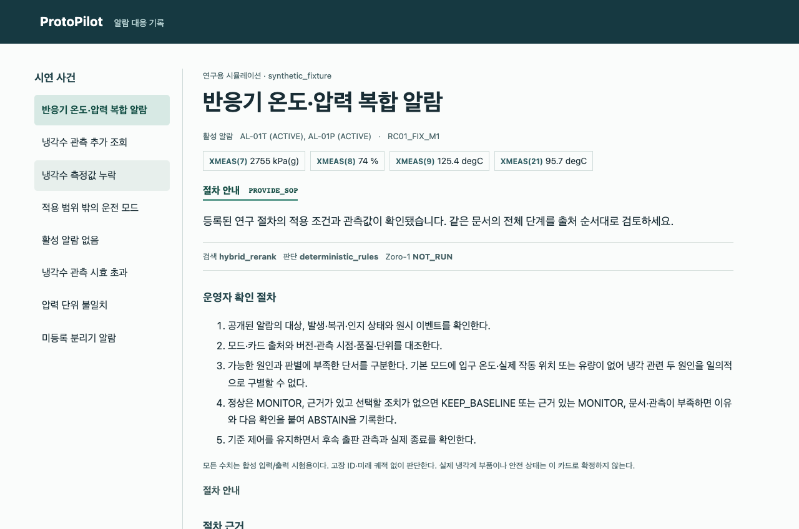

# ProtoPilot

TEP(Tennessee Eastman Process) 시뮬레이션에서 운영자가 알람을 받았을 때, 그 시점에 볼 수 있는 계기값으로 관련 절차를 찾고 출처를 확인하는 대회용 데모다. RC-01은 팀이 작성한 반응기 냉각 이상 연구 카드다. 모든 결과는 시뮬레이션용이다.

## 시연

1. [RAG 실행 안내](rag/README.md)에 따라 복합 알람을 연다. 계기 4개와 운전 모드가 카드의 적용 조건을 만족하면, 검색한 조항과 등록된 판본을 대조해 한국어 5단계와 영어 근거를 표시한다.
2. 같은 입력에서 냉각수 출구 측정값을 빼 본다. `recover`는 추가 관측이 돌아온 뒤 절차를 제시한다. `missing`은 측정값을 받지 못해 운영자 검토로 넘긴다. 각 사건의 판단 이력에서 이 차이를 볼 수 있다.
3. [고정 평가 질문](rag/data/challenge.json)으로 용어 검색, 의미 검색 결합, 재정렬의 결과를 비교한다. 문서 검색 점수와 절차의 적용 조건은 따로 기록한다.

[](examples/operator.html)

## 구성

```text
시점별 공개 알람과 관측
  → 알람 묶음, 최근 관측의 품질·시각 확인
  → 영어 질의와 장비·모드 필터
  → BM25 + BGE-M3 → Qdrant RRF → Qwen3-Reranker-0.6B
  → 문서 판본·적용 조건·근거 대조
  → 절차 안내 / 추가 관측 / 재검색 / 운영자 검토
  → 한국어 안내와 사건별 기록
```

검색에는 공개 체크포인트를 사용한다. 판단 모델 연결부는 Trida의 형식화된 선택과 도구 반환을 지원한다. 이 아카이브의 사건에서는 규칙 판단기를 사용했으며, 실제 Zoro-1 호출 횟수는 0이다. 대회에서 모델이 판단하고 다음 행동을 수행하는 전체 흐름을 검증하려면 사용 승인된 모델 연결이 필요하다. [대회 Track 1](https://hackathon.trillionlabs.co/) · [Zoro-1](https://huggingface.co/trillionlabs/Zoro-1)

## 출처

- TEP 계기의 정의는 Downs와 Vogel의 Table 4를 따랐다. 공개 예제와 교육 시나리오의 단위·장비·출처를 각 검색 항목에 기록했다. [원 논문](https://users.abo.fi/khaggblo/RS/Downs.pdf) · [APMonitor 교육 예제](https://apmonitor.com/apps/tennessee-eastman/instructions.php)
- 검색 모델과 벡터 데이터베이스를 별도로 내려받으며, 모델 판본과 파일 해시를 확인한다. [BAAI BGE-M3](https://huggingface.co/BAAI/bge-m3) · [Qwen3-Reranker-0.6B](https://huggingface.co/Qwen/Qwen3-Reranker-0.6B) · [Qdrant 혼합 검색](https://qdrant.tech/documentation/search/hybrid-queries/)

## 실행 결과

[운영자 화면 다운로드](examples/operator.html) 후 브라우저에서 열면 설치 없이 8개 사건을 살펴볼 수 있다. [로컬 CPU 원본 결과](examples/benchmarks/local-native-cpu.json)에는 독립 Qdrant 서버의 조항별 순위, 준비 시간, 검색 시간, 사건별 판정이 있다. 개발 질의 4개와 별도 양성 질의 9개를 평가했다. 정답 조항을 지정하지 않은 3문항은 적중률 계산에서 제외했다. 같은 문서 9개에서 얻은 소규모 결과다.

| 검색 경로 | 개발 1위 | 별도 양성 1위 | 별도 양성 상위 3위 |
| --- | ---: | ---: | ---: |
| BM25 | 4/4 | 7/9 | 8/9 |
| BM25 + BGE-M3 + RRF | 4/4 | 9/9 | 9/9 |
| 결합 검색 + Qwen 재정렬 | 4/4 | 9/9 | 9/9 |

## TEP Studio의 실제 시뮬레이션 기록

[동일 초기 상태에서 갈라진 두 경로](examples/tep-replay/README.md)를 재계산해 800행의 원 기록과 대조했다. 2시간 시점에 생산 목표를 낮춘 경로는 그 뒤 6시간 동안 누적 제품량이 353.91 L 적었고, 최고 반응기 압력이 0.80 kPa 낮았다. 한 시나리오와 시드에서 얻은 결과다. 이 기록에는 알람 이력과 계기 품질이 없으므로, 시연용 복합 알람 발생 여부는 확인할 수 없다. [두 경로의 수치](examples/tep-replay/comparison.json) · [2시간 시점에서 검색에 전달한 관측](examples/tep-replay/operator-view.json)

### 서울대학교 CSE SGS 실측

임시 CPU 작업에서 공개 가중치와 Qdrant 1.16.2 서버를 띄워 같은 실험을 반복했다. 세 방식의 1위·상위 3위 정답 수가 위 표와 일치했다. 별도 질문 전체 12개(양성 9개와 보류 3개)의 질의 중간값은 BM25 3.0 ms, 결합 검색 143 ms, Qwen 재정렬 추가 시 6.15 s였다. 이 시간에서 모델 준비와 다운로드는 제외했다. 8개 사건의 결과를 회수했고 전용 Pod의 삭제를 확인했다. [SGS 질문별 결과](examples/benchmarks/sgs-cpu.json) · [실행 정보](examples/benchmarks/sgs-cpu-receipt.json)

동일한 입력을 **NVIDIA A100-SXM4-40GB 1장**에서도 실행했다. BM25·결합 검색·재정렬 추가의 질의 중간값은 각각 **1.7 ms, 15.6 ms, 137.0 ms**였다. 별도 양성 9개에서 각각 7개·9개·9개의 정답을 1위로 찾았고, 사건 8개의 판정도 CPU와 일치했다. GPU 작업의 결과 회수와 전용 Pod 삭제를 확인했다. [A100 질문별 결과](examples/benchmarks/sgs-cuda.json) · [A100 실행 정보](examples/benchmarks/sgs-cuda-receipt.json)
